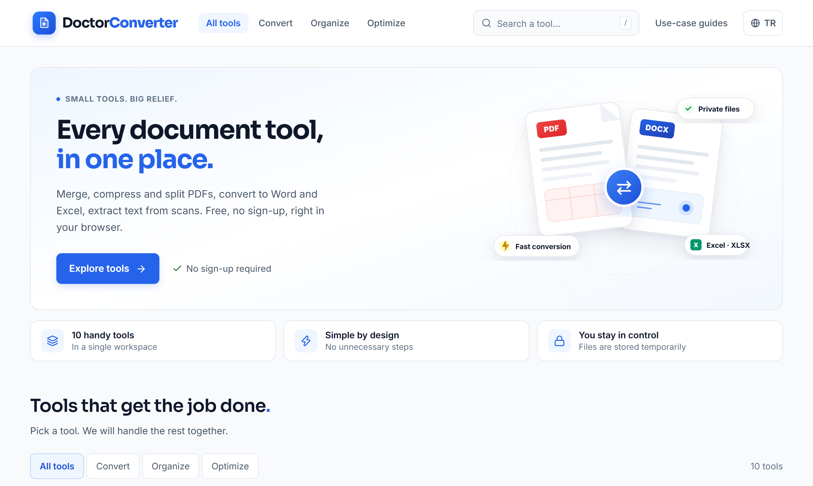
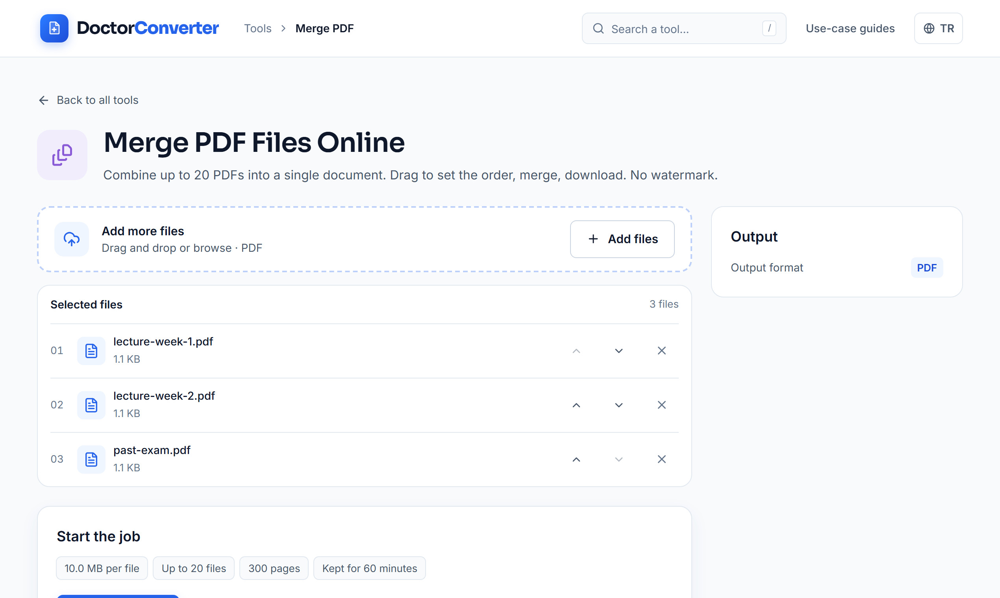
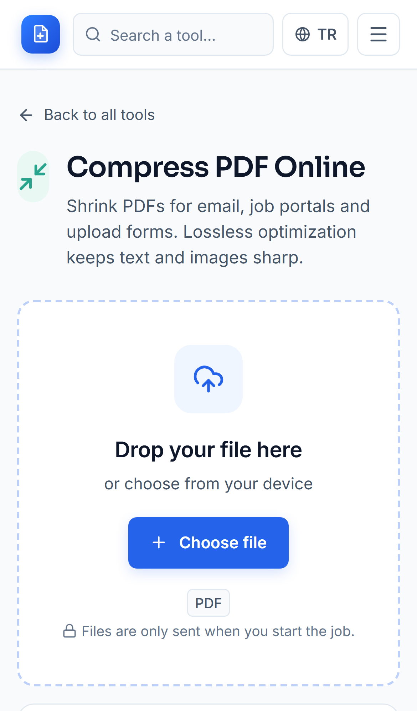
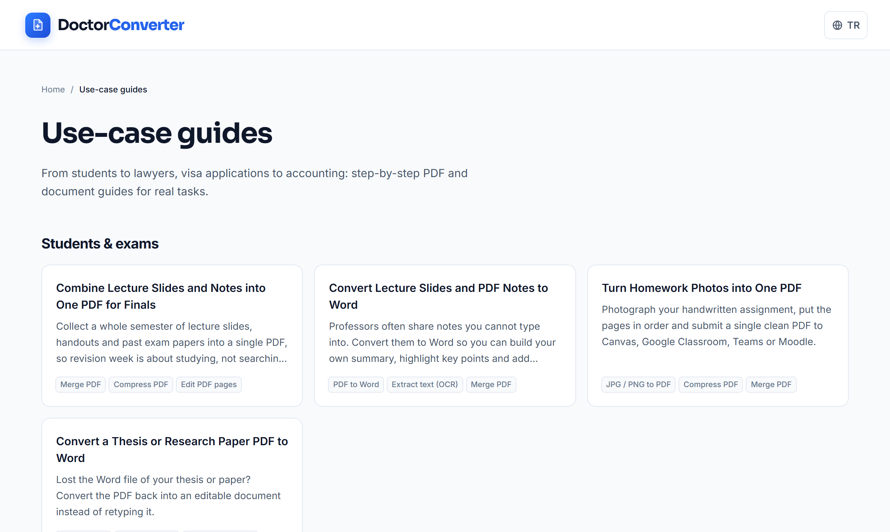
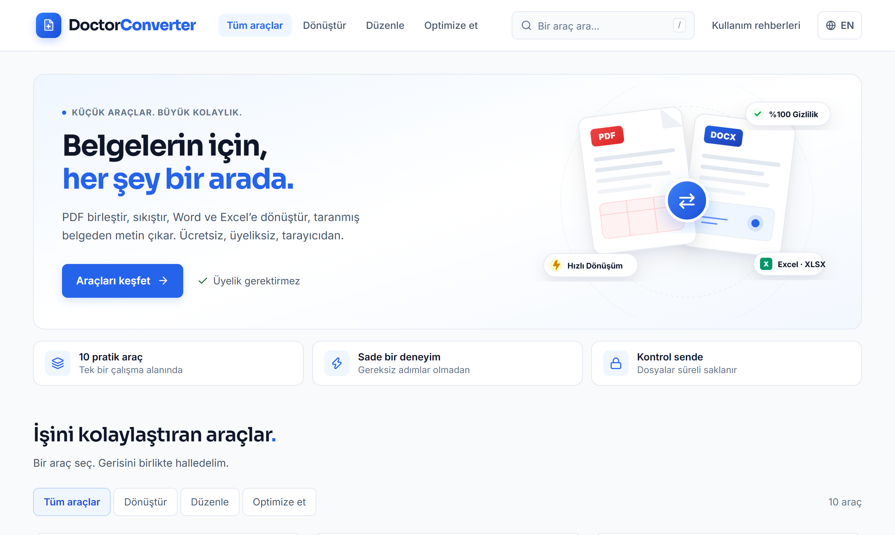
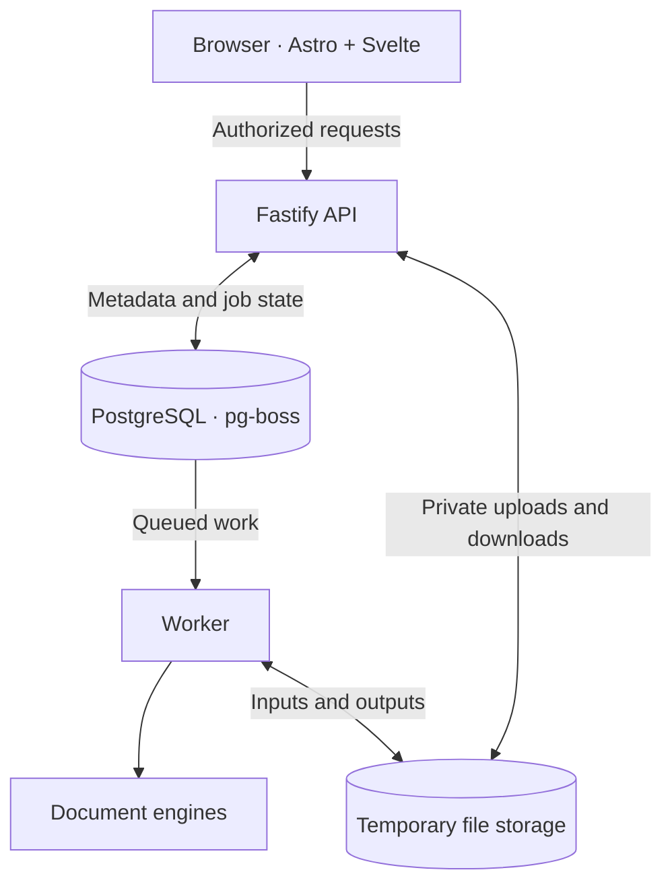

<p align="center">
  
</p>

<h1 align="center">DoctorConverter</h1>

<p align="center">
  <strong>PDF and document tools, all in one place.</strong>
</p>

<p align="center">
  Convert, merge, compress, organize, and extract text from documents — directly in your browser, without an account.
</p>

<p align="center">
  <a href="https://doctorconverter.com"><strong>Open DoctorConverter</strong></a>
  &nbsp;·&nbsp;
  <a href="#features">Explore features</a>
  &nbsp;·&nbsp;
  <a href="#quick-start">Run locally</a>
  &nbsp;·&nbsp;
  <a href="docs/ARCHITECTURE.md">Architecture</a>
</p>

<p align="center">
  <sub>17 registered document tools · 5 interface languages · No sign-up required</sub>
</p>

---

<p align="center">
  
</p>

DoctorConverter is a web application for everyday PDF and office-document tasks. It combines an approachable, multilingual interface with an asynchronous processing backend and self-hosted document engines. Files are handled through session-scoped access and temporary storage rather than a permanent document library.

> [!NOTE]
> **17 tools are registered in the application; registration does not guarantee full support or identical output quality for every document.** Formats, limits, and known engine caveats are documented in [Engine Support](docs/ENGINE-SUPPORT.md) and [Engine Audit](docs/ENGINE-AUDIT.md).

## Features

| Area | Tools |
| --- | --- |
| **Convert documents** | PDF → Word, Word → PDF, PDF → Excel, Excel → PDF, PDF → Markdown, PowerPoint → PDF, PDF → JPG/PNG, JPG/PNG → PDF |
| **Work with PDFs** | Merge PDF, organize/split/rotate pages, compress PDF, add page numbers, add a watermark |
| **Protect PDFs** | Password-protect a PDF, unlock a PDF with the correct password |
| **Extract text** | OCR → TXT, create a searchable PDF with OCR |

### Designed around real workflows

- **No account required.** Choose a tool, select your files, set the available options, and start processing.
- **Clear job states.** The interface distinguishes upload, queueing, processing, success, cancellation, and failure.
- **Multilingual interface.** English, Turkish, Spanish, French, and Hindi; UI language is separate from OCR document-language support.
- **Temporary file access.** Downloads and early deletion are tied to the session that owns the job.
- **Self-hosted processing engines.** Document conversion does not depend on a third-party document-conversion API.

## Product preview

| PDF merge workflow | Mobile experience |
| :---: | :---: |
|  |  |

<details>
<summary><strong>See the guides and Turkish interface</strong></summary>

<p align="center">
  
</p>

<p align="center">
  
</p>

</details>

## How it works

1. **Select a tool** for the document task you need.
2. **Add files and options.** The browser checks basic input constraints; the server validates the request again.
3. **Start processing.** A worker runs the appropriate document engine outside the HTTP request.
4. **Download or delete.** Retrieve your output with the same authorized session, or revoke access early.

Files are uploaded only when the user explicitly starts the operation. Progress is reported according to what can actually be measured; engine processing is not presented as a fabricated percentage.

## Privacy and processing limits

DoctorConverter is designed for temporary, session-owned document processing:

- Input and output bytes are kept in **private temporary storage**, not in public web directories.
- Document bytes are not stored in the application's database, job queue, or application logs.
- The default access retention period is **60 minutes**; the current API policy determines the value shown to users.
- **Early deletion revokes access immediately.** Physical removal happens asynchronously after a safety interval and worker cleanup; it is not necessarily instantaneous.
- Metadata has a separate lifecycle. Long-term metadata pruning and production backup/restore validation remain open operational work.

Document conversion is format-dependent. In particular, PDF → Word can produce editable DOCX content but does **not** guarantee identical page layout; PDF → Excel is oriented toward detectable tables rather than scanned-table reconstruction. OCR accuracy depends on image quality and the selected language models.

For exact tool and file constraints, consult the current [API documentation](docs/API.md), [Engine Support](docs/ENGINE-SUPPORT.md), and the application's live capabilities response. Documented development defaults include **10 MiB per input file** and **40 MiB combined input**, with additional tool-specific limits; these are not verified production-capacity guarantees.

## Technology

| Layer | Technology |
| --- | --- |
| Web | Astro, Svelte, TypeScript, Tailwind CSS |
| API | Fastify, TypeScript |
| Persistence and jobs | PostgreSQL, Drizzle ORM, pg-boss |
| Document processing | QPDF, Poppler, LibreOffice, Tesseract, Python-based adapters |
| Development environment | pnpm workspace, Docker Compose |
| Verification | Type checks, boundary checks, integration tests, Playwright E2E and engine audits |

### Architecture at a glance



The backend follows a modular monolith structure with distinct API, worker, and engine entrypoints. The diagram shows logical responsibilities, not separate production machines or a guarantee of independent resource budgets. See [Architecture](docs/ARCHITECTURE.md) and [Modules](docs/MODULES.md).

## Quick start

**Prerequisites:** Node.js **22.23.4+**, pnpm **10.28.2**, and a running Docker installation.

From the repository root:

```bash
pnpm install --frozen-lockfile
pnpm setup:local
pnpm infra:up
pnpm dev
```

Then open **http://127.0.0.1:4321/**. Use `127.0.0.1`, not `localhost`, for the documented local origin policy.

| Local endpoint | Address |
| --- | --- |
| Web interface | `http://127.0.0.1:4321/` |
| PDF merge experience | `http://127.0.0.1:4321/#tool/merge-pdf` |
| API readiness | `http://127.0.0.1:3001/api/health/ready` |

The setup script preserves an existing `.env` and generates local credentials when needed. `.env` and `.data` are not committed to Git. Docker Compose runs PostgreSQL, migration, API, worker, and document-processing services. The database and engine are not exposed directly to the host.

To stop the local infrastructure:

```bash
pnpm infra:down
```

This stops the Compose services without removing the PostgreSQL volume. Backend source changes require rebuilding the relevant images; `pnpm infra:up` performs the build in this project.

## Testing and verification

```bash
pnpm check       # Import boundaries, types, and applicable i18n checks
pnpm build       # Server type/build step and static web build
pnpm test        # Docker-backed server integration suite
pnpm test:e2e    # Playwright browser suite (requires browser dependencies)
```

`pnpm test` uses real local PostgreSQL, pg-boss, and document engines with synthetic test files. It temporarily coordinates the development worker, so avoid running independent backend test sessions against the same local environment in parallel.

GitHub Actions includes frontend checks and a **non-blocking** backend integration trial job. CI configuration or passing synthetic tests alone do not certify every format, production throughput, or document fidelity. For test scope and specialized audits, see [Testing](docs/TESTING.md).

## Repository layout

```text
apps/
  web/                 Astro + Svelte interface
  server/              Fastify API, worker and document engines
packages/
  contracts/           Shared tool and API contracts
docs/
  agent-roles/         Canonical AI specialist instructions
  ARCHITECTURE.md
  ENGINE-SUPPORT.md
  TESTING.md
  TEAM.md
.claude/agents/        Claude Code adapters
.codex/agents/        Codex adapters
.gemini/agents/       Gemini CLI adapters
.github/agents/        GitHub Copilot adapters
marketing/assets/     Product screenshots and brand assets
```

## Documentation

| Topic | Reference |
| --- | --- |
| Product scope | [Product](docs/PRODUCT.md) |
| Architecture and module contracts | [Architecture](docs/ARCHITECTURE.md) · [Modules](docs/MODULES.md) |
| Supported tools and limitations | [Engine Support](docs/ENGINE-SUPPORT.md) · [Engine Audit](docs/ENGINE-AUDIT.md) |
| API and data lifecycle | [API](docs/API.md) · [File Processing](docs/FILE-PROCESSING.md) · [Data Model](docs/DATA-MODEL.md) |
| Development and tests | [Coding Standards](docs/CODING-STANDARDS.md) · [Testing](docs/TESTING.md) |
| Deployment and outstanding decisions | [Deployment](docs/DEPLOYMENT.md) · [Roadmap](docs/ROADMAP.md) |
| Multi-agent development rules | [AGENTS.md](AGENTS.md) · [AI Team](docs/TEAM.md) |

### Current boundaries

DoctorConverter is an actively developed application, **not a claim of universal conversion fidelity or completed production-readiness validation**. Open areas include representative real-document corpus evaluation, production load/capacity tests, metadata retention decisions, and production backup/restore verification. See the linked evidence and roadmap before depending on any particular capability in a sensitive workflow.

---

<p align="center">
  <strong>DoctorConverter</strong><br />
  Everyday document work, a little simpler.<br />
  <a href="https://doctorconverter.com">doctorconverter.com</a>
</p>
